## Fase 0: Preparación — ISS-00 — Requisitos previos
## 0.1 Node, npm y Angular CLI
Criterios de este sub-ítem

[ ] node -v cumple engines.node de @angular/cli
[ ] npm -v cumple engines.npm
[ ] ng version muestra Angular CLI 22.x
[ ] command -v ng apunta a la instalación npm y no a otro programa

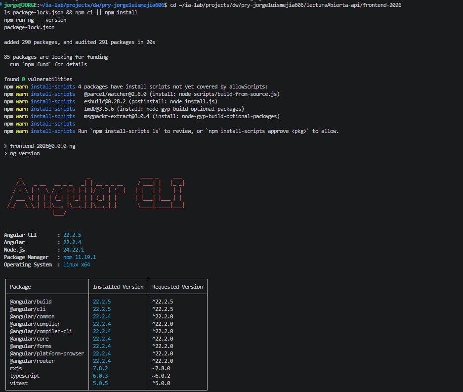

## 0.2 Backend en marcha (preparación para integrar HTTP)
Criterios de este sub-ítem

[ ] npm run db:seed del backend termina sin error
[ ] npm run dev deja el puerto 4000 escuchando
[ ] El log muestra conexión a la BD y sync exitoso
[ ] curl -i http://localhost:4000/api/clientes responde 401 (protegido) o 200 (Fase I)
El esqueleto y /construir funcionan solos. Para operaciones de negocio el frontend consume la API en http://localhost:4000/api. Levanta el backend correcto:

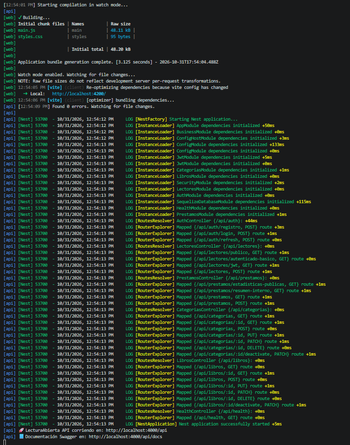

## 0.3 Login y permisos
Criterios de este sub-ítem

[ ] El login (OPEN) devuelve access_token, refresh_token, expires_in y refresh_expires_in
[ ] GET /api/sesion/perfil (JWT) devuelve { user }
[ ] GET /api/permisos (JWT) devuelve una fila por permiso efectivo
[ ] admin obtiene 58 permisos
El login del backend devuelve solo el par de tokens. El perfil y los permisos se piden aparte:

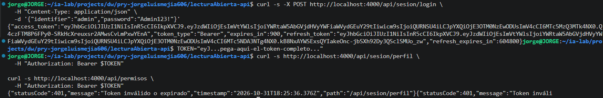

## 0.4 Credenciales del seeder
Criterios de este sub-ítem

[ ] admin / Admin123! inicia sesión y recibe 58 permisos
[ ] seller / Seller123! inicia sesión y recibe 7 permisos
[ ] Un usuario sin rol se autentica pero recibe 403 en recursos RBAC
Usuario	Password	Rol	Permisos
admin	Admin123!	ADMIN	58 recursos
seller	Seller123!	SELLER	7 recursos
El seeder de backend crea además usuarios aleatorios sin rol: sirven para comprobar que estar autenticado no basta (recibirán 403).

Los permisos no están hardcodeados en el frontend: salen de /api/permisos, que ejecuta la misma consulta que el middleware authorize (role_users → roles → resource_roles → resources, todos los eslabones activos).

## 0.5 Navegador y herramientas
Criterios de este sub-ítem

[ ] DevTools (F12) con Console y Network disponibles
[ ] Las peticiones permiten comprobar Authorization: Bearer ...
[ ] No hay bloqueadores que intercepten localhost

Abre DevTools (F12) → Console y Network. En cada ISS comprobarás que las peticiones llevan Authorization: Bearer ....

Instala Angular DevTools (opcional) para inspeccionar componentes y signals.
Desactiva bloqueadores que intercepten localhost si el login falla sin motivo.
0.6 Estructura de trabajo
Criterios de este sub-ítem

[ ] La carpeta del frontend existe
[ ] No contiene src/ ni package.json antes de ISS-01
[ ] Solo contiene docs/ y archivos de configuración del repositorio
El proyecto se crea dentro de la carpeta existente:

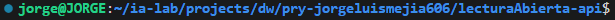

## Verificación del ISS

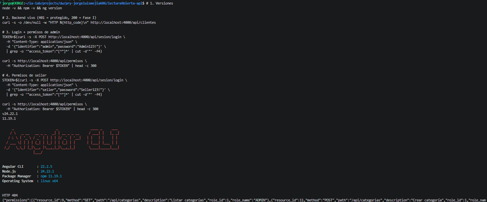

## ISS-01 — Bootstrap Angular 22 con CLI, Tailwind y PrimeNG

## 1.1 Crear el proyecto en la carpeta actual
Criterios de este sub-ítem

[ ] angular.json, package.json, src/main.ts y src/app/app.config.ts en la raíz
[ ] src/app/app.routes.ts generado por --routing
[ ] Tailwind configurado por --style=tailwind (.postcssrc.json)
Solo para una carpeta de práctica vacía: usa el CLI instalado en ISS-00. Si ya descargaste este workspace, ejecuta npm ci y continúa con su revisión; no vuelvas a crearlo. En una ubicación nueva crea primero la carpeta vacía con mkdir -p, entra en ella y ejecuta:

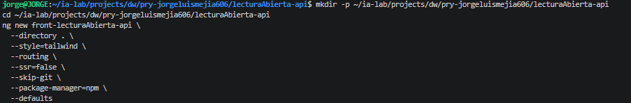

## 1.2 Instalar PrimeNG compatible con Angular
Criterios de este sub-ítem

[ ] primeng, @primeuix/themes, primeicons y @angular/cdk instalados
[ ] Las versiones instaladas declaran compatibilidad con Angular 22
[ ] package-lock.json actualizado y conservado
El tema moderno no se importa desde primeng/resources/themes. El preset Aura vive en @primeuix/themes.

Consulta primero las peer dependencies:

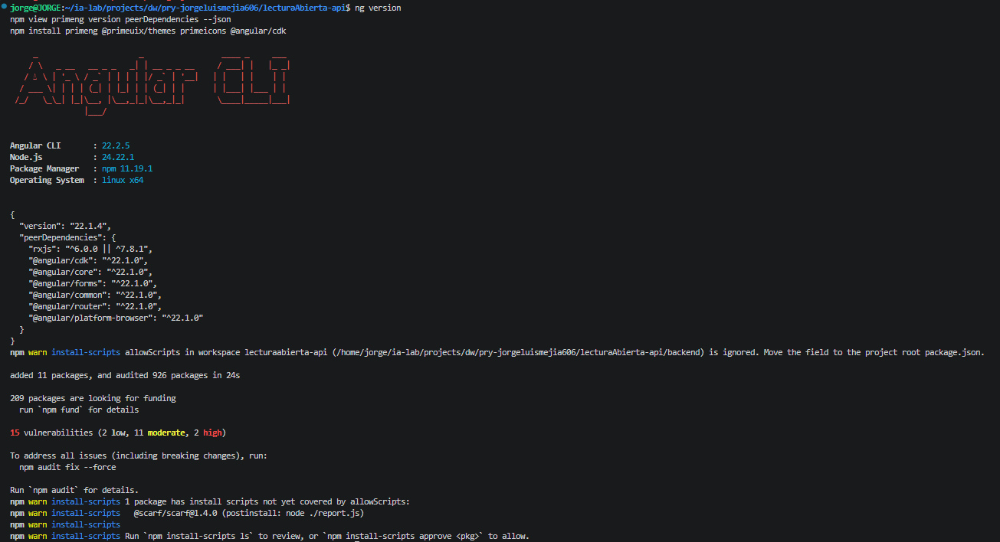

## 1.3 Estilos globales
Criterios de este sub-ítem

[ ] src/styles.css declara @layer theme, base, primeng, utilities;
[ ] Importa tailwindcss
[ ] Importa primeicons/primeicons.css
[ ] No contiene selectores .p-*, ::ng-deep ni clases de aplicación
Crea/reemplaza src/styles.css:

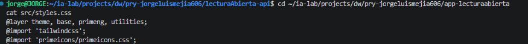

## 1.4 Configurar PrimeNG en app.config.ts
Criterios de este sub-ítem

[ ] providePrimeNG registra preset: Aura
[ ] darkModeSelector: '.app-dark'
[ ] cssLayer declara name: 'primeng' y order: 'theme, base, primeng, utilities'
[ ] MessageService y ConfirmationService registrados
[ ] provideRouter incluye withComponentInputBinding() y withInMemoryScrolling
Reemplaza src/app/app.config.ts:

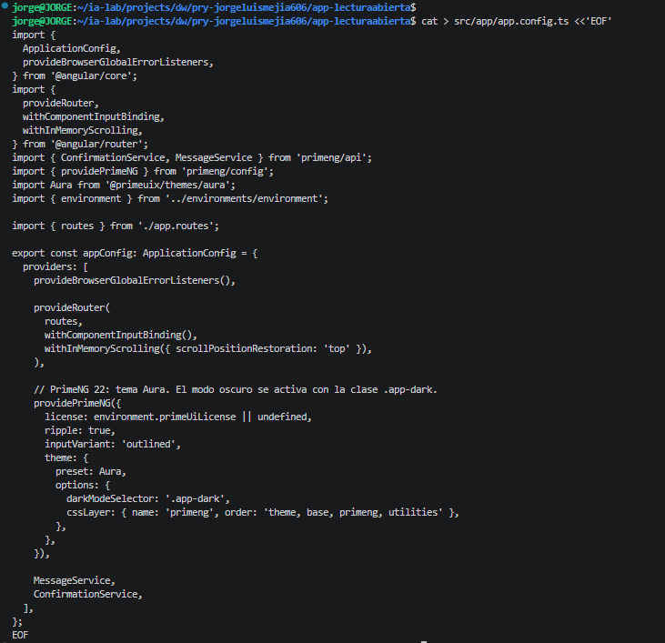

## 1.5 Pantalla de arranque: App compone el componente demo/ejemplo
Criterios de este sub-ítem

[ ] src/app/app.ts importa el componente Ejemplo y lo declara en imports
[ ] src/app/app.html contiene <app-ejemplo /> dentro de un <main> con utilidades Tailwind
[ ] src/app/app.css queda vacío: el aspecto viene de Tailwind y del tema Aura
[ ] src/app/app.spec.ts prueba que app-ejemplo se pinta, en lugar del <h1> por defecto
[ ] src/app/app.routes.ts sigue vacío: en ISS-01 no hay rutas
[ ] Existe src/app/demo/ejemplo/ con ejemplo.ts, ejemplo.html, ejemplo.css y ejemplo.spec.ts
[ ] Al abrir http://localhost:4200 se ve la tarjeta del producto con su precio y sus botones
La plantilla que genera el CLI es una página de bienvenida de Angular llena de enlaces. Se reemplaza, pero no por una pantalla vacía: el resultado de ISS-01 es una pantalla mínima que se ve y que sirve de ejemplo de todo lo que explica 1.9.

La pantalla vive en un componente aparte, demo/ejemplo, para que la explicación no se mezcle con App. App se queda con una sola responsabilidad: poner la etiqueta. No se usa el router todavía: en ISS-01 el objetivo es entender qué es un componente, y eso se ve con una etiqueta en la plantilla. El router aparece en ISS-01B, cuando hay una pantalla de negocio que mostrar.


index.html → <app-root> → App (composición) → <app-ejemplo /> → demo/ejemplo
La regla mental que queda de esta sección: un componente es una etiqueta HTML que se escribe en la plantilla de otro componente. La etiqueta es el selector de su @Component.

src/app/app.ts

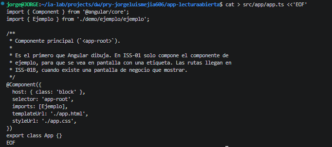

src/app/app.html

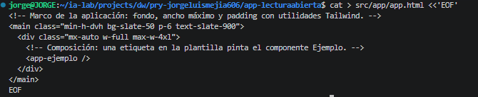

src/app/app.routes.ts

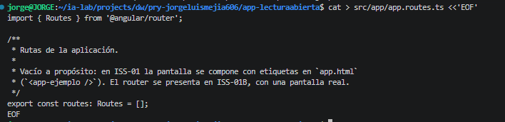

src/app/app.css

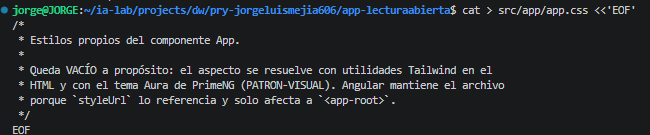

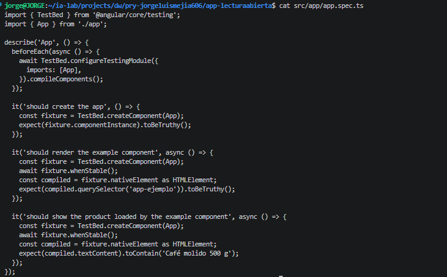
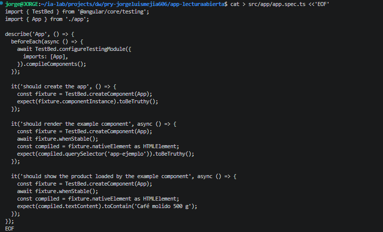

## 1.6 Personalizar index.html
Criterios de este sub-ítem

[ ] lang="es"
[ ] <title>StoreLab Express II · Angular 22</title>
[ ] <body class="m-0 bg-slate-100 font-sans text-slate-900">
[ ] meta description presente

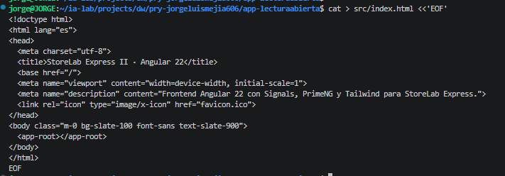

## 1.7 Ajustar el presupuesto de build
Criterios de este sub-ítem

[ ] En projects → … → architect → build → configurations → production → budgets, el presupuesto initial es maximumWarning: "750kB" y maximumError: "1MB"
El bundle inicial con PrimeNG supera los 500 kB por defecto. En angular.json, dentro de projects → ... → architect → build → configurations → production → budgets, cambia el primer presupuesto:

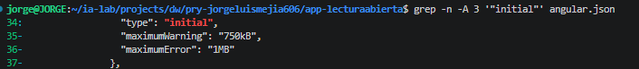

## 1.8 Primera ejecución
Criterios de este sub-ítem

[ ] npm start compila sin errores
[ ] http://localhost:4200 responde 200 y muestra el componente de ejemplo
[ ] Se ve la tarjeta del producto con nombre, precio, estado y botones
[ ] Pulsar +1000 cambia el precio y el «Precio final con IVA» sin recargar la página
[ ] Cambiar estado cambia la etiqueta (Activo/Inactivo) y el mensaje inferior
[ ] Escribir en Nombre actualiza el texto «Vista previa»
[ ] Console muestra [ejemplo] … en cada cambio (lo escribe effect())
[ ] Network carga styles.css, main.js y los chunks con estado 200
[ ] El <title> de la pestaña es StoreLab Express II · Angular 22

```bash
npm start
```

